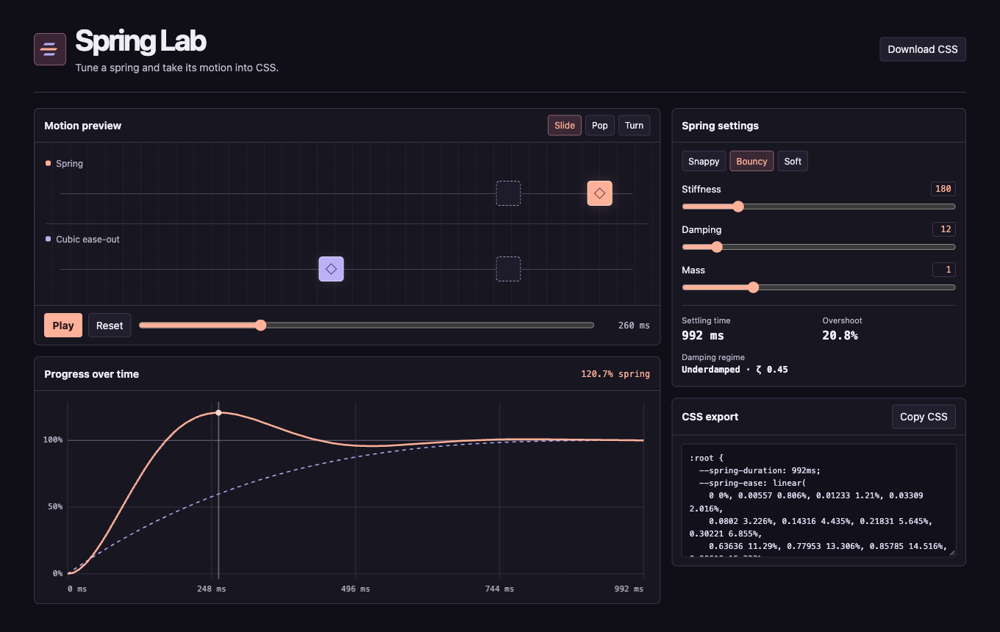

# Spring Lab

A visual workbench for spring motion. Adjust stiffness, damping, and mass, compare the result with cubic ease-out, then export the motion as CSS.

## Start

Open [dist/index.html](dist/index.html) in a browser. Pick a preset or tune a spring manually, choose Slide, Pop, or Turn, and use Play or the scrubber. You can also scrub by dragging across the chart.

Use **Copy CSS** or **Download CSS**. Apply the generated stylesheet to an element with the class **spring-target** and toggle **is-active** to trigger the transition. The preview and export use the same control points in CSS **linear()**. [CSS Easing Functions](https://drafts.csswg.org/css-easing-2/#the-linear-easing-function)

Settling time is estimated from the last sampled point outside the position and speed thresholds. The simulator uses a damped oscillator with a fixed target and an initial velocity of zero.

## Develop

Run **npm test** for oscillator, settling, and export tests. Run **npm run build** to regenerate the standalone HTML. The build and tests use Node.js and have no package dependencies.
